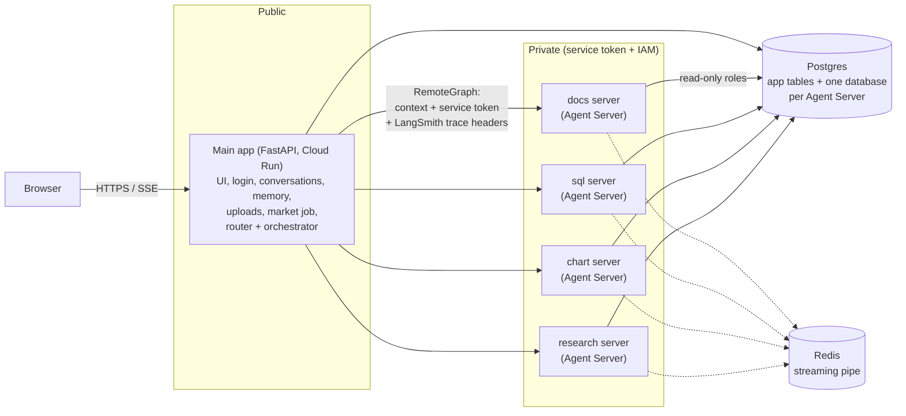

# Smallie Architecture

A FastAPI multi-agent AI app. A rule-based router sends each message to one specialist agent, or to an orchestrator that answers itself, hands off to a specialist, or asks several specialists and writes the answer.

This file describes `main` plus the 0.4.0 work in progress (remote agents, section 10). Code-level detail lives in `CLAUDE.md`; the 0.4.0 design is in `docs/superpowers/specs/2026-10-20-remote-agents-design.md`.

---

## 1. Overview

### Technology Stack

**Frontend**

- Plain HTML/JS (no framework)
- Chat view with message history
- Agent badges showing which agent answered
- Real-time streaming via Server-Sent Events (SSE)
- Language toggle: English / Vietnamese
- Document upload UI with progress tracking (PDF, DOCX)
- Charts rendered with Chart.js

**Backend**

- FastAPI on Google Cloud Run (Python 3.12, async)
- LangGraph for workflow orchestration (message routing + agent management)
- LangChain agents (specialists + orchestrator)
- OpenRouter API for LLM and embedding calls (free tier + server-side fallback models)
- MCP (Model Context Protocol) servers for web search, Wikipedia, arXiv
- Optional LangSmith tracing for debugging (section 11)

**Database**

- Postgres 18 on Neon (Singapore region) in production; Postgres 18 in Docker for local development
- pgvector extension for semantic search (embeddings)
- One connection pool shared by the LangGraph checkpointer and store

**Key Deployment**

- Cloud Run: 1 instance max, no CPU throttling (background tasks run after the response)
- Neon Postgres: direct URL (not the pooler, because of advisory locks)
- Artifact Registry for container images

### Architecture Diagram (today: one service)

```
┌─────────────────────────────────────────────────────────────────┐
│                          Browser                                │
│  (HTML/JS) ─ Chat view, documents, charts, language toggle      │
└────────────────────┬────────────────────────────────────────────┘
                     │ SSE / HTTPS
                     ↓
┌─────────────────────────────────────────────────────────────────┐
│                    Google Cloud Run                             │
│  FastAPI + LangGraph (async, 1 GiB RAM, no CPU throttling)      │
│                                                                 │
│  Startup (lifespan):                                            │
│    1. Turn on LangSmith tracing if configured                   │
│    2. Init DB tables (SQLAlchemy Core)                          │
│    3. Open AsyncPostgresSaver (checkpointer) + Store            │
│    4. Load MCP servers (Tavily, Wikipedia, arXiv)               │
│    5. Build assistant graph (router → agents/orchestrator)      │
│    6. Start market price scheduler (daily update)               │
│                                                                 │
│  Routes:                                                        │
│    POST /api/chat/{kind}   ─ Main message endpoint              │
│    GET  /api/agents        ─ Agent info + labels                │
│    POST /api/signup        ─ Create account (max 20)            │
│    GET  /api/conversations ─ Conversation list                  │
│    POST /api/documents     ─ Upload files (PDF/DOCX)            │
│                                                                 │
│  Assistant Graph (built once at startup):                       │
│    START → router → {docs|sql|chart|research|orchestrator}      │
│           ↓ (rule-based, no model)                              │
│           └─ fallback (if the specialist gives up)              │
└────────────────────┬────────────────────────────────────────────┘
                     │ psycopg async driver (TCP keepalives)
                     ↓
┌─────────────────────────────────────────────────────────────────┐
│                    Neon Postgres 18                             │
│                                                                 │
│  Tables:                                                        │
│    users, conversations, documents (+ summary)                  │
│    LangGraph checkpointer: checkpoints, checkpoint_blobs,       │
│                            checkpoint_writes                    │
│    LangGraph store: store, store_vectors                        │
│    document chunks: langchain_pg_embedding (pgvector)           │
│    graph_nodes, graph_edges (knowledge graph)                   │
│    market.stocks, market.daily_prices (stock data)              │
│                                                                 │
│  Extensions: pgvector (HNSW index up to 2000 dims, else flat)   │
└─────────────────────────────────────────────────────────────────┘
```

---

## 2. Life Cycle of a Message

### Request Phase

1. **User sends a message**
   - POST `/api/chat/{kind}`, where kind is "auto" or a specific agent route
   - Message ≤ 8,000 characters
2. **Authentication and context**
   - Verify the session cookie → `user_id`
   - Load or create the conversation
   - Recall the newest 20 facts from the knowledge graph
   - Load the last turns of the 3 most recent other chats (cross-chat memory)
   - Build `AgentContext(user_id, user, memories, recent_chats, agent=kind)`
3. **Stream start**
   - Begin the SSE stream and emit a `conversation` event with id + title
   - Start the LangGraph assistant on the conversation's thread (loads prior messages from the checkpointer)

### Routing Phase

4. **Router decides (rule-based, no model)**
   - If `kind != "auto"`: use the forced route (e.g. `/api/chat/docs` → docs agent)
   - Otherwise check whether the message obviously points to one agent:
     - Hints: keyword regex ("documents", "stock", "research", ...)
     - Matches: ticker symbols, file names
   - Obvious and no other agent mentioned: send it to that agent directly
   - Else: send it to the orchestrator
5. **Stream routing event**: an SSE `agent` event with the router's choice

### Execution Phase

6. **The selected agent or the orchestrator runs**
   - Sees the full thread (all prior messages)
   - Calls its tools (`search_documents`, `run_sql`, web search, ...)
   - Streams tokens, `tool_call` and `tool_result` events
7. **Typical tool calls**
   - `run_sql`: a pipe table for the model + the full table as an artifact
   - `search_documents`: passages with file names and pages
   - `ask_<agent>`: runs another agent as a tool, result capped
   - `chart_table`: charts an earlier table artifact
   - `tavily_tavily_search`: web search through Tavily's MCP server

### Streaming Phase

8. **Events streamed to the browser**
   - `token`: text as it is generated
   - `tool_call`: which tool is called with which arguments
   - `tool_result`: tool output, plus charts
   - The UI renders as events arrive

### Completion Phase

9. **Turn completes**
   - A final `done` event
   - A specialist's reply stays in the thread with its tool calls and results (so "plot that" finds the table later). When the orchestrator answers, only its final message enters the thread; what it asked specialists streams to the UI but stays out of later prompts.
   - The checkpointer saves the thread
10. **Background: fact extraction** (after the response is sent)
    - Only when the orchestrator answered (`_answered_by(messages)`)
    - One model call extracts facts from the question + answer
    - Facts are saved to the knowledge graph (with dedup + embedding search)

---

## 3. Router

### Purpose

Decides which agent or the orchestrator handles the message **without calling a model**. Fast, deterministic routing.

### How It Works

**Input**: the latest user message + the agents available to this user

**Decision logic**:

1. **Forced route**: the API picked the agent (`/api/chat/docs`)
2. **Obvious route**: the message matches exactly one agent's hints or matches, and mentions no other agent
3. **Default**: the orchestrator (mixed or ambiguous questions)

**Output**: `{"route": "<agent>", "direct": bool}`

- `direct=True`: the router picked the agent itself; if it finds no answer, the orchestrator takes over (fallback)
- `direct=False`: forced or handed off; no fallback

### Routing Signals

**Hints** (keyword regex):

- docs: "documents", "files", "PDFs", "uploads", "tài liệu"
- sql: "stocks", "tickers", "market cap", "p/e", "cổ phiếu"
- chart: "chart", "plot", "graph" (overrides sql for "chart AAPL")
- research: "research", "look it up", "search online", "latest news"

**Matches** (deterministic checks):

- docs: the user's file names
- sql: known stock tickers (AAPL, MSFT, ...)

**Mentions** (weaker signal, blocks obvious routing):

- "my resume" next to "AAPL" → orchestrator (docs and sql both mentioned)

### Special Cases

- Research always continues to the orchestrator (router → research → orchestrator writes up the findings)
- The chart agent has `overrides=("sql",)` ("chart AAPL" goes to chart, not sql)
- No documents uploaded: the docs agent is unavailable and skipped in routing

---

## 4. Orchestrator

### Purpose

The "front door" agent. Answers general questions itself, asks specialists as tools (in parallel), or hands off to one specialist.

### System Prompt Includes

- Today's date
- The available specialists and how to use them (`ask_docs`, `handoff`, ...)
- Web search availability (Wikipedia alongside every web search)
- Per-request notes:
  - which specialists are unavailable (no files)
  - the user's file names + summaries
  - the agent that gave the previous answer
  - which agents the message mentions, when it mentions several

### Tool Set

**Specialist tools** (for agents with a `tool_description`):

- `ask_docs(question)`: search the user's files
- `ask_sql(question)`: query the stock database; returns a summary + the full table as an artifact
- `ask_chart(question)`: draw a chart
- `ask_research(question)`: run the researcher (up to 8 model calls); returns cited findings

**Web search**:

- `tavily_tavily_search`: Tavily web search
- `knowledge_wikipedia_search`: Wikipedia

**Own tools**:

- `chart_table(table_id)`: chart an earlier SQL result
- `chart_data(...)`: chart inline numbers
- `handoff(agent)`: give the whole message to one specialist

### Decision Process

**Call 1** (deciding, short prompt):

- The model reads the message + the available agents
- Decides, e.g. "ask sql for the data, then chart it" or "search the web"
- No format rules yet (keeps tokens low)

**Call 2+** (writing up):

- Tool results are in (parallel calls run concurrently)
- Format rules + citation rules + reply language are added

### Max Model Calls

- 4 per message by default (`ORCHESTRATOR_MAX_MODEL_CALLS`)
- `no_repeats` middleware skips identical repeated tool calls and caps `ask_<agent>` per message

### Handoff

When the orchestrator calls `handoff(agent)`:

- The tool ends the orchestrator's loop (`return_direct`), and the node returns `Command(goto=<agent>)`
- That specialist answers on the thread directly
- Free models rarely choose `handoff` themselves, so `prefer_handoff` turns a first step that asks exactly one specialist into a handoff

### Cost & Performance

- **General question**: 1 model call (+1 for fact extraction after the reply)
- **Obvious specialist question**: 2–5 calls
- **Composed answer**: 1 + each specialist's calls + 1
- **Free tier cost**: ~$0.000005–$0.00003 per message

---

## 5. Documents Agent

### What It Does

Answers from the user's uploaded PDF/DOCX files using RAG (Retrieval-Augmented Generation).

### Upload & Ingestion

1. The user uploads a file via POST `/api/documents`
2. A FastAPI background task:
   - splits it into chunks: 800 characters, 120 overlap
   - embeds each chunk with baai/bge-m3 (1024 dims)
   - stores them in the pgvector collection "documents", with deterministic ids `"{document_id}:{i}"` (used for deletion)
   - sets the status to "ready" or "failed"
3. Document card (best effort, never changes the status):
   - one model call on the start of the file: type, summary, up to 10 entities
   - stored in the knowledge graph as File -mentions-> Entity edges
   - `documents.summary` is shown in the file list

### Search

- `search_documents(query, entity)` searches the user's chunks by similarity
- Scoped search: when the question names an entity the graph links to some files, only those files are searched
- Falls back to all files if the scoped search finds nothing

### Citations

- Format: `[filename, p. N]`

### Route Info

- Available when the user has at least one ready document
- Prompt note: the newest files with their summaries
- Mentions: distinctive words of file names, resume/CV words

---

## 6. SQL and Chart Agents

### SQL Agent

**Data source**: the stock database (`market` schema)

- 200 stocks, updated daily from yfinance
- Tables: `stocks` (profiles), `daily_prices` (OHLC)

**How it works**

1. Introspects the schema at startup (columns, FKs, comments, sample rows)
2. Bakes the schema description into its system prompt
3. Writes SQL and runs it as a read-only role
4. Returns a pipe table (capped at 200 rows for the model) + the full table as an artifact (≤ 2000 rows)

**Safety**

- Read-only role `agent_readonly` (SELECT only on `market`)
- Read-only transactions, 10 s timeout
- Only a single SELECT/WITH statement is accepted
- Row caps: the model sees 200, the artifact keeps 2000

**Tool**: `run_sql(query)`

### Chart Agent

**Draws charts** from:

- an earlier query result (`chart_table(table_id)`)
- inline numbers (`chart_data(...)`)
- a new query (`chart_sql(query)`)

**Chart spec** (`ChartSpec`):

- Types: line, bar, area, pie, scatter
- ≤ 8 series in a fixed palette order
- Pies folded to ≤ 8 slices with "Other"; scatter ≤ 3 series
- More than 500 points are downsampled

**Reuse**

- "Plot that" reuses an earlier table by id
- The same query again (case and spacing ignored) reuses its table instead of running it again

**Artifacts**

- The model sees a short summary; the chart spec travels as an artifact the UI renders (palette + light/dark theme)
- Building a chart is no model call, and no model ever copies data points

---

## 7. Research Agent

### Purpose

Gathers information from several sources (web, Wikipedia, arXiv, the user's files, the stock data) and returns cited findings for the orchestrator to write up.

### Workflow

One-node StateGraph:

- `gather`: runs the researcher, collects its findings, returns them to the orchestrator

**Key property**: `answers_directly=False`

- The researcher never answers the user directly
- The orchestrator writes the answer in one of its formats (summary, list, structured report, comparison, company brief)

### Tools Available

**MCP servers** (loaded at startup):

- `tavily_tavily_search`, `tavily_tavily_extract`: web search and page extraction (Tavily)
- `knowledge_wikipedia_search`, `knowledge_wikipedia_page`, `knowledge_arxiv_search`: Wikipedia and arXiv
- Skipped (credit-hungry): Tavily crawl, map, research

**Plus shared tools**:

- `search_documents`: the user's files
- `run_sql`: the stock database
- `load_skill`: researcher skills, loaded on demand

### Citation Pipeline

1. **The researcher writes findings** with short source ids:
   ```
   [source: S4a2c | "Apple's stock rose 5%"]
   ```
   where `S4a2c` = S + 4 hex characters of the URL's SHA1
2. **The `cite_by_id` middleware** appends a `[source ids]` list to every tool result, so the researcher can pick ids instead of writing URLs
3. **`expand_source_ids`** turns ids back into title + URL + quote
4. **`link_sources`** checks quotes against the fetched pages (and whole Wikipedia articles) and adds passage links
5. **The orchestrator formats the findings**: `[1][2]` numbers in the text and a numbered Sources list at the end

### Performance

- Researcher: up to 8 model calls per message (default)
- Total: roughly 5–20 s depending on sources

### Special Features

- **Web + Wikipedia together**: every Wikipedia search comes with a web search in the same step (except arXiv questions)
- **Cut short**: if the researcher hits its call cap, its latest raw tool results go to the orchestrator, marked "GAPS: research incomplete"

---

## 8. Memory

### Short-term (per conversation)

**Checkpointer**: `AsyncPostgresSaver`

- Saves the thread after every step (`checkpoints`, `checkpoint_blobs`, `checkpoint_writes` tables)
- Thread id = conversation id
- All agents share the thread, so all see the full history
- Enables "plot that" (finds the earlier table artifact)

### Long-term (per user, across chats)

**Knowledge graph** (plain Postgres tables, not a graph database):

- `graph_nodes`: the User node, entity nodes, file nodes (kind, name, normalized name, embedding)
- `graph_edges`: relations between nodes (e.g. `works_at`, `interested_in`, `studied_at`), with provenance (`chat`, `document`, `import`) and timestamps

**Extraction**

1. After an orchestrator turn, `extract_facts(question, answer)` runs as a background task
2. One model call with structured output (up to 8 facts)
3. The model sees the user's files + relations already in the graph (to reuse their names)
4. Pydantic validates: relations are snake_case, known wordings map to a standard relation ("is_named" → "has_name")

**Deduplication**

- **Normalization**: "John", "john", "John." are the same name
- **Embedding match**: a new entity name with cosine similarity ≥ 0.85 to a known one reuses that node
- **Functional relations**: e.g. `works_at` has one value per user; a new one replaces the old edge
- **Anchor filter**: only facts touching the User or one of the user's files are kept
- **One edge per node pair**: a standard relation wins over an invented one
- **Orphan cleanup**: entities without edges are deleted

**Recall** (every chat)

- `recall_facts(user_id)`: one SQL query for the newest 20 facts at the User node
- Passed to every agent as `AgentContext.memories` and added to its prompt

**Search**

- `search_memory(query)`: the 5 nearest entity nodes by embedding, then the edges touching them
- Available to every agent

### Cross-Chat Memory

**Recent chats** (every message)

- The last 3 turns of the 3 most recently used other conversations
- Passed as `AgentContext.recent_chats` and added to the prompt

**Searchable history** (after each turn)

- The question + answer are saved under the store namespace `("users", user_id, "history")`, indexed with pgvector
- Tool: `search_chat_history(query)` finds earlier turns

### Why Postgres Tables, Not a Graph Database?

**Pros**

- One database (no separate graph database to run)
- Cheap (standard Postgres + pgvector), works on Cloud Run + Neon
- ACID transactions
- Embeddings with pgvector
- Full control over dedup (relations, entity merging)

**Cons**

- Multi-hop paths need explicit JOINs
- No graph algorithms (PageRank, community detection)
- Dedup is our own code

**Trade-off**: enough for user facts and file mentions without running Neo4j. The tables are laid out as vertex + edge tables, so a future Postgres `CREATE PROPERTY GRAPH` can sit on top.

---

## 9. Architecture Highlights

### Thread per Conversation

One LangGraph thread per conversation, so every agent sees the full history:

- follow-up questions work across agents
- "plot that table" finds the earlier SQL result
- context stays consistent when the conversation switches agents

### Artifacts, Not Data in Prompts

Tables and charts travel as `ToolMessage` artifacts (and on the orchestrator's final message as `additional_kwargs`):

- the model only sees a summary, never the data points
- the UI and other agents read the artifact from the thread
- saves tokens and stops models from copying numbers wrongly

### Hidden Messages

Research findings and a failed specialist attempt reach the orchestrator as hidden messages:

- the model reads them to write its answer
- they are never saved to the thread

### Multi-language

Every agent prompt ends with `LANGUAGE_RULE` + `MEMORY_RULE`:

- every reply is in the language of the user's latest message (English or Vietnamese)
- embeddings: baai/bge-m3 (multilingual)

### Free Tier Constraints

- ~20 requests/min and a low daily cap
- Strategies:
  - prefer handoff (saves the orchestrator's write-up call)
  - cap tool results (data doesn't bloat prompts)
  - `no_repeats` middleware (no loops)
  - fact extraction only after orchestrator turns, not after plain lookups

---

## 10. Remote Agents (0.4.0, in progress)

### Goal

Each specialist (docs, sql, chart, research) runs as its own private **LangGraph Agent Server**. The main app calls them through `RemoteGraph`. This is a learning project for production-grade tools, and it lets agents be deployed and scaled on their own later.

### Diagram



### Key Decisions

| Topic | Decision |
|---|---|
| Protocol | `RemoteGraph` to LangGraph Agent Servers (free "lite" mode). Each server also serves A2A, so other frameworks can join later. |
| State | Specialists are **stateless**: the main app owns every conversation and all memory. |
| Communication | Agents never talk to each other directly. Every call goes through the main app (hub and spoke), which keeps call limits, security and tracing in one place. |
| Security | Specialists are private: a service token (Agent Server custom auth) everywhere, plus Cloud Run IAM in production. Read-only database roles. |
| Adding an agent | One compose service, one `AGENT_URLS` entry, one Cloud Run service from the shared image. No router, orchestrator or wrapper changes. |
| Cost | Free tiers only: Cloud Run scales to zero (cold starts accepted), Neon and Upstash Redis sleep when idle. |

### How a Call Travels

```
main app                                         sql server (private)
  │ POST /runs/stream (no thread: stateless)        │
  │   headers: service token, user id,              │
  │            LangSmith trace headers              │
  │   body: messages + AgentContext                 │
  │ ───────────────────────────────────────────────►│ token check → run graph
  │ ◄─────────── SSE: tokens, tool calls, results ──│
  │ ◄─────────── final state: new messages + tables │ keeps only run records,
  ▼                                                 not the conversation
adds the new messages to the conversation (the only copy)
```

### Status

| Phase | State |
|---|---|
| 0. Spikes (feasibility) | done |
| 1. Local Postgres in Docker | done |
| 2. LangSmith tracing | done |
| 3. Agent server image + compose stack | done (plan Tasks 4–5: one image, 4 servers in compose, end-to-end checked) |
| 4. `RemoteAgent` wrapper in the main app | done (plan Tasks 1–3: `RemoteAgent`, the main app calls every specialist through it) |
| 5. Security (service token, IAM, read-only roles) | done (plan Tasks 6–7: Cloud Run ID tokens; `agent_reader` for the app's data, `agent_server` for the servers' own databases; calls the main app gave up on are cancelled) |
| 6. Cloud Run deployment | config and steps written (plan Task 8: `cloudbuild.agent.yaml`, README "Deploying"); first deploy pending |

**Database roles.** Each agent server uses three logins, none of which can touch accounts or chats:

| Login | Used for | Can |
|---|---|---|
| `agent_reader` (`DATABASE_URL`) | the agents' searches | read documents, the knowledge graph and chat history; the main app grants these tables at every start |
| `agent_readonly` (`READONLY_DATABASE_URL`) | SQL and chart queries | read the `market` schema |
| `agent_server` (`DATABASE_URI`) | the Agent Server's own run queue | own the four `agent_<route>` databases; can't open the app's database |

---

## 11. Debugging with LangSmith

Optional, off by default. With `LANGSMITH_TRACING=true` and `LANGSMITH_API_KEY` set, every chat message becomes one trace in the LangSmith project `smallie`: the router's choice, each agent, each model call with its full prompt, each tool call with its result, tokens and time per step. Chat traces carry the user's id as metadata, so they can be filtered per user. After 0.4.0's remote agents, one trace covers the main app and the specialist servers it called.

Traces contain full prompts (users' messages, file passages, memories), so tracing in production is a deliberate choice.

---

## 12. Deployment

**Local development**

- Windows + WSL Ubuntu; Docker inside WSL runs Postgres 18 + pgvector, Redis and the four agent servers (`docker compose up -d`, ports 2101–2104)
- `uv sync` installs the dependencies
- `uv run uvicorn app.api.main:app --reload --loop asyncio:SelectorEventLoop`

**Cloud deployment**

- Always from `main`
- Update `CHANGELOG.md` + the version in `pyproject.toml` first
- Main app: `gcloud run deploy smallie --source . --region asia-southeast1 ...` (public URL, login required)
- Agent servers: one image built by `gcloud builds submit --config cloudbuild.agent.yaml`, then one private service per agent (`smallie-<route>`, `--no-allow-unauthenticated`, its own env file); the main app's service account has `roles/run.invoker` on each
- Neon Postgres (direct URL, no pooler): the app's database plus one small database per agent server

**Services**

- Google Cloud Run (project `smallie-review`, region `asia-southeast1`): `smallie` plus `smallie-docs`, `smallie-sql`, `smallie-research`, `smallie-chart`
- Neon Postgres 18 (Singapore)
- Upstash Redis (free; the agent servers' streaming pipe, one key prefix per server)
- OpenRouter (free tier or paid; chat and embedding models)
- Tavily (optional, web search)
- LangSmith (optional, tracing)
