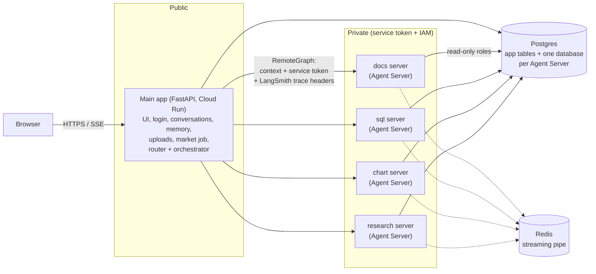
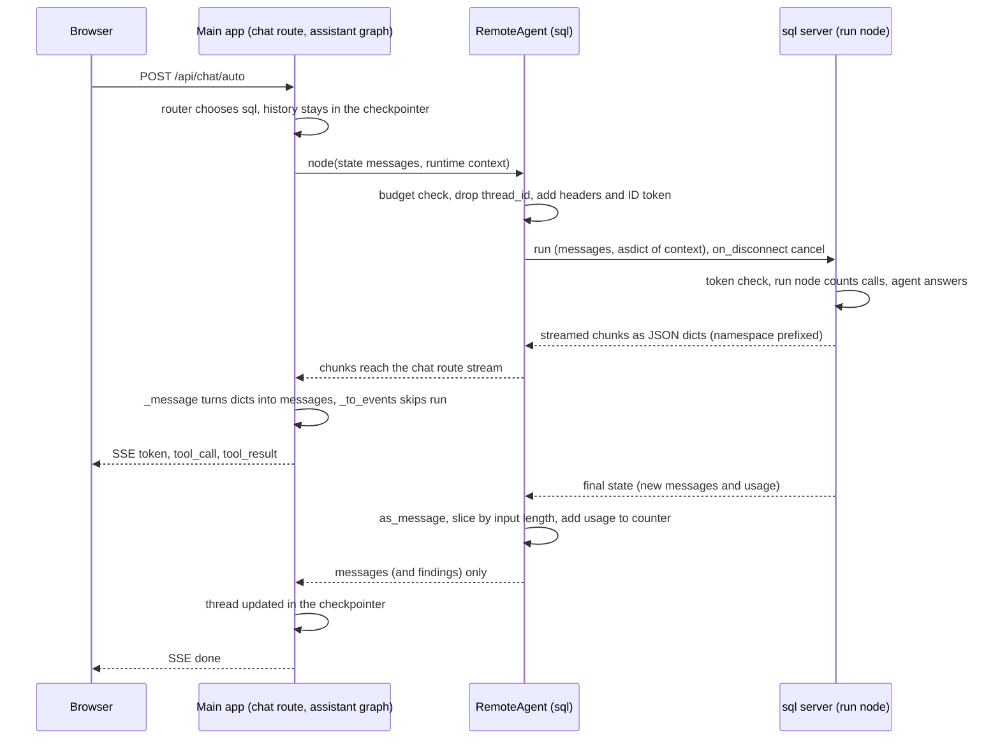

# Smallie Architecture

A FastAPI multi-agent AI app. A rule-based router sends each message to one specialist agent, or to an orchestrator that answers itself, hands off to a specialist, or asks several specialists and writes the answer. In team mode (section 11) a plan splits the work into tasks for the agents and a judge checks the results.

This file describes `main` plus the 0.4.0 remote agents (section 10) and the 0.5.0 agent team (section 11). Code-level detail lives in `CLAUDE.md` and `.claude/rules/`; the 0.4.0 design is in `docs/superpowers/specs/2026-10-20-remote-agents-design.md`.

---

## 1. Overview

### Technology Stack

**Frontend**

- Plain HTML/JS (no framework)
- Chat view with message history
- Agent badges showing which agent answered
- Real-time streaming via Server-Sent Events (SSE)
- Language toggle: English / Vietnamese
- Document upload UI with progress tracking (PDF, DOCX)
- Charts rendered with Chart.js

**Backend**

- FastAPI on Google Cloud Run (Python 3.12, async)
- LangGraph for workflow orchestration (message routing + agent management)
- LangChain agents (specialists + orchestrator)
- Each user's own OpenAI-compatible endpoint for chat calls (section 14); OpenRouter API for embeddings only
- MCP (Model Context Protocol) servers for web search, Wikipedia, arXiv
- Optional LangSmith tracing for debugging (section 12)

**Database**

- Postgres 18 on Neon (Singapore region) in production; Postgres 18 in Docker for local development
- pgvector extension for semantic search (embeddings)
- One connection pool shared by the LangGraph checkpointer and store

**Key Deployment**

- Cloud Run: 1 instance max, no CPU throttling (background tasks run after the response)
- Neon Postgres: direct URL (not the pooler, because of advisory locks)
- Artifact Registry for container images

### Architecture Diagram (logical parts; section 10 shows the services)

```
┌─────────────────────────────────────────────────────────────────┐
│                          Browser                                │
│  (HTML/JS) ─ Chat view, documents, charts, language toggle      │
└────────────────────┬────────────────────────────────────────────┘
                     │ SSE / HTTPS
                     ↓
┌─────────────────────────────────────────────────────────────────┐
│                    Google Cloud Run                             │
│  FastAPI + LangGraph (async, 1 GiB RAM, no CPU throttling)      │
│                                                                 │
│  Startup (lifespan):                                            │
│    1. Turn on LangSmith tracing if configured                   │
│    2. Init DB tables (SQLAlchemy Core)                          │
│    3. Open AsyncPostgresSaver (checkpointer) + Store            │
│    4. Load MCP servers (Tavily, Wikipedia, arXiv)               │
│    5. Build assistant graph (router → agents/orchestrator)      │
│    6. Start market price scheduler (daily update)               │
│                                                                 │
│  Routes:                                                        │
│    POST /api/chat/{kind}   ─ Main message endpoint (auto, team, │
│                              or one agent)                      │
│    GET  /api/agents        ─ Agent info + labels                │
│    POST /api/signup        ─ Create account (max 20)            │
│    GET  /api/conversations ─ Conversation list                  │
│    POST /api/documents     ─ Upload files (PDF/DOCX)            │
│                                                                 │
│  Assistant Graph (built once at startup):                       │
│    START → router → {docs|sql|chart|research|orchestrator|team} │
│           ↓ (rule-based, no model)                              │
│           └─ fallback (if the specialist gives up)              │
└────────────────────┬────────────────────────────────────────────┘
                     │ psycopg async driver (TCP keepalives)
                     ↓
┌─────────────────────────────────────────────────────────────────┐
│                    Neon Postgres 18                             │
│                                                                 │
│  Tables:                                                        │
│    users, conversations, documents (+ summary, card_embedding)  │
│    LangGraph checkpointer: checkpoints, checkpoint_blobs,       │
│                            checkpoint_writes                    │
│    LangGraph store: store, store_vectors                        │
│    document chunks: langchain_pg_embedding (pgvector)           │
│    graph_nodes, graph_edges (knowledge graph)                   │
│    market.stocks, market.daily_prices (stock data)              │
│                                                                 │
│  Extensions: pgvector (HNSW index up to 2000 dims, else flat)   │
└─────────────────────────────────────────────────────────────────┘
```

---

## 2. Life Cycle of a Message

### Request Phase

1. **User sends a message**
   - POST `/api/chat/{kind}`, where kind is "auto", "team" (section 11) or a specific agent route
   - Message ≤ 8,000 characters
2. **Authentication and context**
   - Verify the session cookie → `user_id`
   - Load or create the conversation
   - Recall the newest 20 facts from the knowledge graph
   - Load the last turns of the 3 most recent other chats (cross-chat memory)
   - Build `AgentContext(user_id, user, memories, recent_chats, agent=kind, ...)` (also `notes`, `mentioned`, `sources`, `failed`)
3. **Stream start**
   - Begin the SSE stream and emit a `conversation` event with id + title
   - Start the LangGraph assistant on the conversation's thread (loads prior messages from the checkpointer)

### Routing Phase

4. **Router decides (rule-based, no model)**
   - If `kind == "team"`: go to the team task graph (section 11)
   - If `kind` is an agent route: use the forced route (e.g. `/api/chat/docs` → docs agent)
   - Otherwise check whether the message obviously points to one agent:
     - Hints: keyword regex ("documents", "stock", "research", ...)
     - Matches: ticker symbols, file names
   - Obvious and no other agent mentioned: send it to that agent directly
   - Else: send it to the orchestrator
5. **Stream routing event**: an SSE `agent` event with the router's choice

### Execution Phase

6. **The selected agent or the orchestrator runs**
   - Sees the full thread (all prior messages)
   - Calls its tools (`search_documents`, `run_sql`, web search, ...)
   - Streams tokens, `tool_call` and `tool_result` events
7. **Typical tool calls**
   - `run_sql`: a pipe table for the model + the full table as an artifact
   - `search_documents`: passages with file names and pages
   - `ask_<agent>`: runs another agent as a tool, result capped
   - `chart_table`: charts an earlier table artifact
   - `tavily_tavily_search`: web search through Tavily's MCP server

### Streaming Phase

8. **Events streamed to the browser**
   - `token`: text as it is generated
   - `tool_call`: which tool is called with which arguments (with `agent` when a specialist the orchestrator asked made it)
   - `tool_result`: tool output, plus charts
   - Team mode adds `plan`, `plan_updated`, `wave`, `spoke`, `review`, `synthesize`, `needs_human` and `charts` events
   - The UI renders as events arrive

### Completion Phase

9. **Turn completes**
   - A final `done` event
   - A specialist's reply stays in the thread with its tool calls and results (so "plot that" finds the table later). When the orchestrator answers, only its final message enters the thread; what it asked specialists streams to the UI but stays out of later prompts.
   - The checkpointer saves the thread
10. **Background: fact extraction** (after the response is sent)
    - Only when the orchestrator answered (`_answered_by(messages)`)
    - One model call extracts facts from the question + answer
    - Facts are saved to the knowledge graph (with dedup + embedding search)

---

## 3. Router

### Purpose

Decides which agent or the orchestrator handles the message **without calling a model**. Fast, deterministic routing.

### How It Works

**Input**: the latest user message + the agents available to this user

**Decision logic**:

1. **Forced route**: the API picked the agent (`/api/chat/docs`)
2. **Obvious route**: the message matches exactly one agent's hints or matches, and mentions no other agent
3. **Default**: the orchestrator (mixed or ambiguous questions)

**Output**: `{"route": "<agent>", "direct": bool}`

- `direct=True`: the router picked the agent itself; if it finds no answer, the orchestrator takes over (fallback)
- `direct=False`: forced or handed off; no fallback

### Routing Signals

**Hints** (keyword regex):

- docs: "documents", "files", "PDFs", "uploads", "tài liệu"
- sql: "stocks", "tickers", "market cap", "p/e", "cổ phiếu"
- chart: "chart", "plot", "graph" (overrides sql for "chart AAPL")
- research: "research", "look it up", "search online", "latest news"

**Matches** (deterministic checks):

- docs: the user's file names
- sql: known stock tickers (AAPL, MSFT, ...)

**Mentions** (weaker signal, blocks obvious routing):

- "my resume" next to "AAPL" → orchestrator (docs and sql both mentioned)

### Special Cases

- Research always continues to the orchestrator (router → research → orchestrator writes up the findings)
- The chart agent has `overrides=("sql",)` ("chart AAPL" goes to chart, not sql)
- No documents uploaded: the docs agent is unavailable and skipped in routing

---

## 4. Orchestrator

### Purpose

The "front door" agent. Answers general questions itself, asks specialists as tools (in parallel), or hands off to one specialist.

### System Prompt Includes

- Today's date
- The available specialists and how to use them (`ask_docs`, `handoff`, ...)
- Web search availability (Wikipedia alongside every web search)
- Per-request notes:
  - which specialists are unavailable (no files)
  - the user's file names + summaries
  - the agent that gave the previous answer
  - which agents the message mentions, when it mentions several

### Tool Set

**Specialist tools** (for agents with a `tool_description`):

- `ask_docs(question)`: search the user's files
- `ask_sql(question)`: query the stock database; returns a summary + the full table as an artifact
- `ask_chart(question)`: draw a chart
- `ask_research(question)`: run the researcher (up to 8 model calls); returns cited findings

**Web search**:

- `tavily_tavily_search`: Tavily web search
- `knowledge_wikipedia_search`: Wikipedia

**Own tools**:

- `chart_table(table_id)`: chart an earlier SQL result
- `chart_data(...)`: chart inline numbers
- `handoff(agent)`: give the whole message to one specialist

### Decision Process

**Call 1** (deciding, short prompt):

- The model reads the message + the available agents
- Decides, e.g. "ask sql for the data, then chart it" or "search the web"
- No format rules yet (keeps tokens low)

**Call 2+** (writing up):

- Tool results are in (parallel calls run concurrently)
- Format rules + citation rules + reply language are added

### Max Model Calls

- 4 per message by default (`ORCHESTRATOR_MAX_MODEL_CALLS`)
- `no_repeats` middleware skips identical repeated tool calls and caps `ask_<agent>` per message
- `trim_tool_calls` middleware (`app/agents/factory.py`, every agent) drops repeated tool calls of one model reply and keeps at most 8 (`MAX_TOOL_CALLS_PER_STEP`)
- `MAX_OUTPUT_TOKENS` (default 32768, reasoning tokens count too) ends a reply that repeats itself, instead of letting it run to 131k tokens
- `CHAT_TEMPERATURE` (default 0.3) is the sampling temperature of chat models; at 0 a repeating reply keeps repeating, higher values let weaker models slip words of another script into Vietnamese answers
- `make_last_call` middleware (`app/agents/factory.py`, every agent but the orchestrator) makes the last allowed model call write the answer: no tool choice, a note (`LAST_CALL_NOTE`) naming the reply language, and any tool call the model makes anyway is dropped
- `tool_errors` middleware (`app/agents/factory.py`, every agent) returns a tool's exception to the model as an error result instead of ending the run; interrupts and handoffs (`GraphBubbleUp`) pass through

### Handoff

When the orchestrator calls `handoff(agent)`:

- The tool ends the orchestrator's loop (`return_direct`), and the node returns `Command(goto=<agent>)`
- That specialist answers on the thread directly
- Free models rarely choose `handoff` themselves, so `prefer_handoff` turns a first step that asks exactly one specialist into a handoff

### Cost & Performance

- **General question**: 1 model call (+1 for fact extraction after the reply)
- **Obvious specialist question**: 2–5 calls
- **Composed answer**: 1 + each specialist's calls + 1

---

## 5. Documents Agent

### What It Does

Answers from the user's uploaded PDF/DOCX files using RAG (Retrieval-Augmented Generation).

### Upload & Ingestion

1. The user uploads a file via POST `/api/documents`
2. A FastAPI background task:
   - splits it into chunks: 800 characters, 120 overlap
   - embeds each chunk with baai/bge-m3 (1024 dims)
   - stores them in the pgvector collection "documents", with deterministic ids `"{document_id}:{i}"` (used for deletion)
   - sets the status to "ready" or "failed"
3. Document card (best effort, never changes the status):
   - one model call on the start of the file: type, summary, up to 10 entities
   - stored in the knowledge graph as File -mentions-> Entity edges
   - `documents.summary` is shown in the file list
   - `documents.card_embedding`: a vector of `"<filename>: <summary>"` (filename alone without a card), embedded in the same request as the entities; `scripts.build_graph` backfills it, `scripts.reindex` resizes it

### Search

- `search_documents(query, entity)` searches the user's chunks by similarity
- Name scope: `entity` or the question names a file without its extension (every file with that name); only those files are searched
- Graph scope: `entity` or a known entity in the question that the graph links to some files; only those files are searched
- No scope: the query is embedded once; the `CARD_FILES` = 3 files nearest by `card_embedding` each get one reserved slot with their best passage, nearest card first; the unscoped top `TOP_K` fills the rest, skipping duplicates, so a large file cannot crowd out a small one. With no card vectors, the plain unscoped search
- Falls back to all files if the scoped search finds nothing

### Citations

- Format: `[filename, p. N]`

### Route Info

- Available when the user has at least one ready document
- Prompt note: the newest files with their summaries
- Mentions: distinctive words of file names, resume/CV words

---

## 6. SQL and Chart Agents

### SQL Agent

**Data source**: the stock database (`market` schema)

- 200 stocks, updated daily from yfinance
- Tables: `stocks` (profiles), `daily_prices` (OHLC)

**How it works**

1. Introspects the schema at startup (columns, FKs, comments, sample rows)
2. Bakes the schema description into its system prompt
3. Writes SQL and runs it as a read-only role
4. Returns a pipe table (capped at 200 rows for the model) + the full table as an artifact (≤ 2000 rows)

**Safety**

- Read-only role `agent_readonly` (SELECT only on `market`)
- Read-only transactions, 10 s timeout
- Only a single SELECT/WITH statement is accepted
- Row caps: the model sees 200, the artifact keeps 2000

**Tool**: `run_sql(query)`

### Chart Agent

**Draws charts** from:

- an earlier query result (`chart_table(table_id)`)
- inline numbers (`chart_data(...)`)
- a new query (`chart_sql(query)`)

**Chart spec** (`ChartSpec`):

- Types: line, bar, area, pie, scatter
- ≤ 8 series in a fixed palette order
- Pies folded to ≤ 8 slices with "Other"; scatter ≤ 3 series
- More than 500 points are downsampled

**Reuse**

- "Plot that" reuses an earlier table by id
- The same query again (case and spacing ignored) reuses its table instead of running it again

**Artifacts**

- The model sees a short summary; the chart spec travels as an artifact the UI renders (palette + light/dark theme)
- Building a chart is no model call, and no model ever copies data points

---

## 7. Research Agent

### Purpose

Gathers information from several sources (web, Wikipedia, arXiv, the user's files, the stock data) and returns cited findings for the orchestrator to write up.

### Workflow

One-node StateGraph:

- `gather`: runs the researcher, collects its findings, returns them to the orchestrator

**Key property**: `answers_directly=False`

- The researcher never answers the user directly
- The orchestrator writes the answer in one of its formats (summary, list, structured report, comparison, company brief)

### Tools Available

**MCP servers** (loaded at startup):

- `tavily_tavily_search`, `tavily_tavily_extract`: web search and page extraction (Tavily)
- `knowledge_wikipedia_search`, `knowledge_wikipedia_page`, `knowledge_arxiv_search`: Wikipedia and arXiv
- Skipped (credit-hungry): Tavily crawl, map, research

**Plus shared tools**:

- `search_documents`: the user's files
- `run_sql`: the stock database
- `load_skill`: researcher skills, loaded on demand

### Citation Pipeline

1. **The researcher writes findings** with short source ids:
   ```
   [source: S4a2c | "Apple's stock rose 5%"]
   ```
   where `S4a2c` = S + 4 hex characters of the URL's SHA1
2. **The `cite_by_id` middleware** appends a `[source ids]` list to every tool result, so the researcher can pick ids instead of writing URLs
3. **`expand_source_ids`** turns ids back into title + URL + quote
4. **`link_sources`** checks quotes against the fetched pages (and whole Wikipedia articles) and adds passage links
5. **The orchestrator formats the findings**: `[1][2]` numbers in the text and a numbered Sources list at the end

### Performance

- Researcher: up to 8 model calls per message (default)
- Total: 126–156 s per question when research took part (relay measurement, 2026-10-24; see section 11)

### Special Features

- **Web + Wikipedia together**: every Wikipedia search comes with a web search in the same step (except arXiv questions)
- **Cut short**: if the researcher hits its call cap, its latest raw tool results go to the orchestrator, marked "GAPS: research incomplete"

---

## 8. Memory

### Short-term (per conversation)

**Checkpointer**: `AsyncPostgresSaver`

- Saves the thread after every step (`checkpoints`, `checkpoint_blobs`, `checkpoint_writes` tables)
- Thread id = conversation id
- All agents share the thread, so all see the full history
- Enables "plot that" (finds the earlier table artifact)

### Long-term (per user, across chats)

**Knowledge graph** (plain Postgres tables, not a graph database):

- `graph_nodes`: the User node, entity nodes, file nodes (kind, name, normalized name, embedding)
- `graph_edges`: relations between nodes (e.g. `works_at`, `interested_in`, `studied_at`), with provenance (`chat`, `document`, `import`) and timestamps

**Extraction**

1. After an orchestrator turn, `extract_facts(question, answer)` runs as a background task
2. One model call with structured output (up to 8 facts)
3. The model sees the user's files + relations already in the graph (to reuse their names)
4. Pydantic validates: relations are snake_case, known wordings map to a standard relation ("is_named" → "has_name")

**Deduplication**

- **Normalization**: "John", "john", "John." are the same name
- **Embedding match**: a new entity name with cosine similarity ≥ 0.85 to a known one reuses that node
- **Functional relations**: e.g. `works_at` has one value per user; a new one replaces the old edge
- **Anchor filter**: only facts touching the User or one of the user's files are kept
- **One edge per node pair**: a standard relation wins over an invented one
- **Orphan cleanup**: entities without edges are deleted

**Recall** (every chat)

- `recall_facts(user_id)`: one SQL query for the newest 20 facts at the User node
- Passed to every agent as `AgentContext.memories` and added to its prompt

**Search**

- `search_memory(query)`: the 5 nearest entity nodes by embedding, then the edges touching them
- Available to every agent
- `same_memory_results` middleware (`app/agents/factory.py`): a memory tool result equal to an earlier result of the same tool in this run (the same lines, in any order) comes back as a short note (`SAME_RESULT`), not the same text again

### Cross-Chat Memory

**Recent chats** (every message)

- The last 3 turns of the 3 most recently used other conversations
- Passed as `AgentContext.recent_chats` and added to the prompt

**Searchable history** (after each turn)

- The question + answer are saved under the store namespace `("users", user_id, "history")`, indexed with pgvector
- Tool: `search_chat_history(query)` finds earlier turns

### Why Postgres Tables, Not a Graph Database?

**Pros**

- One database (no separate graph database to run)
- Cheap (standard Postgres + pgvector), works on Cloud Run + Neon
- ACID transactions
- Embeddings with pgvector
- Full control over dedup (relations, entity merging)

**Cons**

- Multi-hop paths need explicit JOINs
- No graph algorithms (PageRank, community detection)
- Dedup is our own code

**Trade-off**: enough for user facts and file mentions without running Neo4j. The tables are laid out as vertex + edge tables, so a future Postgres `CREATE PROPERTY GRAPH` can sit on top.

---

## 9. Architecture Highlights

### Thread per Conversation

One LangGraph thread per conversation, so every agent sees the full history:

- follow-up questions work across agents
- "plot that table" finds the earlier SQL result
- context stays consistent when the conversation switches agents

### Artifacts, Not Data in Prompts

Tables and charts travel as `ToolMessage` artifacts (and on the orchestrator's final message as `additional_kwargs`):

- the model only sees a summary, never the data points
- the UI and other agents read the artifact from the thread
- saves tokens and stops models from copying numbers wrongly

### Hidden Messages

Research findings and a failed specialist attempt reach the orchestrator as hidden messages:

- the model reads them to write its answer
- they are never saved to the thread

### Multi-language

Every agent prompt ends with `LANGUAGE_RULE` + `MEMORY_RULE`:

- every reply is in the language of the user's latest message (English or Vietnamese)
- embeddings: baai/bge-m3 (multilingual)

### Free Tier Constraints

- Rate limits and daily caps are the user's own endpoint's (the figures below were measured on OpenRouter's free models, ~20 requests/min and a low daily cap)
- Strategies:
  - prefer handoff (saves the orchestrator's write-up call)
  - cap tool results (data doesn't bloat prompts)
  - `no_repeats` middleware (no loops)
  - fact extraction only after orchestrator turns, not after plain lookups

---

## 10. Remote Agents (0.4.0)

### Goal

Each specialist (docs, sql, chart, research) runs as its own private **LangGraph Agent Server**. The main app calls them through `RemoteGraph`. This is a learning project for production-grade tools, and it lets agents be deployed and scaled on their own later.

### Diagram



### Key Decisions

| Topic | Decision |
|---|---|
| Protocol | `RemoteGraph` to LangGraph Agent Servers (free "lite" mode). Each server also serves A2A, so other frameworks can join later. |
| State | Specialists are **stateless**: the main app owns every conversation and all memory. |
| Communication | Agents never talk to each other directly. Every call goes through the main app (hub and spoke), which keeps call limits, security and tracing in one place. |
| Security | Specialists are private: a service token (Agent Server custom auth) everywhere, plus Cloud Run IAM in production. Read-only database roles. |
| Adding an agent | One compose service, one `AGENT_URLS` entry, one Cloud Run service from the shared image. No router, orchestrator or wrapper changes. |
| Cost | Free tiers only: Cloud Run scales to zero (cold starts accepted), Neon and Upstash Redis sleep when idle. |

### How a Call Travels

```
main app                                         sql server (private)
  │ POST /runs/stream (no thread: stateless)        │
  │   headers: service token, user id,              │
  │            LangSmith trace headers              │
  │   body: messages + AgentContext                 │
  │ ───────────────────────────────────────────────►│ token check → run graph
  │ ◄─────────── SSE: tokens, tool calls, results ──│
  │ ◄─────────── final state: new messages + tables │ keeps only run records,
  ▼                                                 not the conversation
adds the new messages to the conversation (the only copy)
```

### Inside an Agent Server

All four servers run **one image**, `smallie-agent` (`Dockerfile.agent`, built on the `langchain/langgraph-api` base image in "lite" mode). The environment variable `AGENT_ROUTE` (`docs`, `sql`, `chart` or `research`) decides which specialist a container serves. No per-agent server file exists.

**Entry point.** `langgraph.json` lists one graph, `agent`, which points at `make_graph` in `app/agents/server.py`. The Agent Server calls that factory on every run, so `make_graph` builds the graph only once, under an `asyncio.Lock`, and keeps it for the life of the process. The build does three things (`server.py:_build`):

1. Looks up the spec for `AGENT_ROUTE` in `agents/registry.py` (an unknown route fails with a clear error).
2. Awaits the spec's `prepare` if it has one (research loads its MCP tools there).
3. Opens the memory store (see below) and wraps `spec.build()` in the `run` graph.

**The `run` node.** `reporting_graph` compiles a one-node graph named `run` (`RUN_NODE`, shared with the main app) around the specialist. The node does this:

1. Starts a fresh `UsageCounter` and adds it to the run's callbacks next to the stream handlers, so tokens and tool events still flow to the caller.
2. Invokes the specialist on the messages it received, with the same `AgentContext`.
3. Returns only the **new** messages (the result minus the input length), the `usage` totals (model calls, tokens, cost, including nested agents such as research's researcher) and, if present, `findings`.

Only the new messages go back, because the Agent Server would otherwise stream the whole thread a second time as tool events.

| A server holds | A server does not hold |
|---|---|
| Its own database `agent_<route>` (owned by `agent_server`) with the Agent Server's tables: the run queue and run records | The user's conversation: the main app's thread is the only copy |
| Redis (one database per server locally, one `REDIS_KEY_PREFIX` per server on Cloud Run), the pipe that carries a run's output from worker to HTTP stream | Checkpoints of the user's thread: calls carry no `thread_id` |
| The specialist graph, its tools and, for research, its MCP sessions | Write access to app data (see "Database roles") |
| A read-only handle on the app's memory store | The user's identity: the main app sends it with every call |

**Memory store.** `search_chat_history` needs the app's chat history, but a server's own Agent Server store is empty. So `_build` calls `open_history_store` (`core/memory.py`), which opens a small pool (max 2 connections) on the app's database with `agent_reader` and registers it with `set_history_store`. It never calls `setup()` (the main app creates the tables, and this role cannot write), and the search passes `refresh_ttl=False` because the TTL refresh is an UPDATE.

**Job settings.** Set in `docker-compose.yml` (`x-agent-env`):

| Setting | Value | Why |
|---|---|---|
| `BG_JOB_MAX_RETRIES` | `1` | Despite the name it counts attempts: `1` runs once, `0` never runs. A run cut off by a restart is not repeated, because that would spend model calls twice. |
| `BG_JOB_TIMEOUT_SECS` | `360` | Backstop for a run whose cancel never arrived. The main app gives up after `AGENT_TIMEOUT_S` (300 s). |
| `LANGGRAPH_POSTGRES_POOL_MAX_SIZE` / `DB_POOL_SIZE` | `5` / `2` | Small pools, so several processes fit under Neon's connection cap. |
| `on_disconnect="cancel"` | sent by `RemoteAgent` | A call the main app stopped waiting for (timeout, chat closed) stops on the server instead of finishing uncounted. |

**Secrets that only research gets.** `TAVILY_API_KEY`, `MCP_SERVERS` and `EXTERNAL_DATABASE_URL` are blanked for docs, sql and chart in `docker-compose.yml`, and only the research service reads them from `.env`. In production, only research's Cloud Run env file holds them.

### Authentication

A call to a specialist passes two independent checks.

| Layer | What it checks | Where |
|---|---|---|
| Service token | The header `x-service-token` must equal the server's `SERVICE_TOKEN`. Compared as bytes with `hmac.compare_digest`, so an odd header value gives 401, never a crash. An unset `SERVICE_TOKEN` refuses everyone (fails closed). | `agents/server_auth.py` (`langgraph.json` → `auth`); the client side is `make_client` in `remote.py` |
| Cloud Run IAM | On Cloud Run (`K_SERVICE` set), `RemoteAgent` adds `Authorization: Bearer <Google ID token>`. The token comes from the metadata server for the service's URL, is cached per URL until its `exp` minus 5 minutes (at most 50 minutes), and only callers with `roles/run.invoker` pass. Off Cloud Run, `id_token` returns `None` and no header is sent. | `remote.py:id_token`, `_token_ttl` |

**Who decides identity.** Only the main app: `get_current_user` (the session cookie) fixes the `user_id`. The servers trust the main app after the token check: `authenticate` returns the `x-smallie-user-id` header as the caller's identity (or `main-app` when it is missing), and tools read the same id from `AgentContext.user_id` in the request body. A leaked token would let a caller claim any user id, so the token is a secret of the main app and the servers only. The header `x-smallie-*` reaches the graph through `http.configurable_headers` in `langgraph.json`.

### Database roles

The servers never write app data. Every login below has only what its job needs:

| Login | Used by | Can | Cannot |
|---|---|---|---|
| Owner (`DATABASE_URL` of the main app) | The main app only | Everything: creates tables, writes accounts, chats, documents, the graph, stock data | Never given to a server |
| `agent_reader` (`DATABASE_URL` of a server) | docs and research searches, the memory store, graph and chat-history tools | `SELECT` on `READER_TABLES` (`documents`, `graph_nodes`, `graph_edges`, `model_settings`, the pgvector tables, the store tables), in read-only transactions with a 10 s timeout. `grant_reader` (`core/db.py`) grants them at the end of every app start, because on a fresh database the tables exist only after the app creates them. | Read accounts, conversations or checkpoints; any write or DDL |
| `agent_readonly` (`READONLY_DATABASE_URL`) | sql and chart stock queries | `SELECT` on the `market` schema; read-only transactions, 10 s timeout, search path `market` | Read any app table |
| `agent_server` (`DATABASE_URI` of a server) | The Agent Server's own tables | Own the four `agent_<route>` databases (`05_agent_databases.sql`) | Open the app's database: `06_agent_reader.sql` revokes `CONNECT` from `PUBLIC` and grants it only to named roles |

Why: a bug or a prompt injection in a specialist can then read at most what it already searches, and cannot change or delete user data. Code on a server must not write: no DDL, no TTL refresh, PGVector with `create_extension=False` (the documents feature's `start` creates its tables).

### Messages and context

Each specialist is a `RemoteAgent` (`app/agents/remote.py`) that calls a server. The graph in `orchestration/graph.py` builds one node per agent from it.

| Topic | How it works |
|---|---|
| The agent node | `add_node(route, RemoteAgent.node)` (`build_assistant`). `node` sends `state["messages"]` and `runtime.context` through `RemoteAgent.ainvoke` |
| How the specialist sees the conversation | Gets the thread's messages in the request body on each call (a direct route) or only a self-contained question (`ask_<route>`). The main app's thread stays the only copy |
| Per-request context (`AgentContext`) | Sent as `asdict(context)` in the body; the server rebuilds the dataclass and tools read it the same way. The user id also goes in the header `x-smallie-user-id` |
| Thread and state | `thread_id` is removed from the config, so the run is stateless and leaves no thread behind. `checkpoint_ns` is kept: `RemoteGraph` uses it to prefix streamed chunks with the parent's namespace, which `_to_events` relies on |
| What comes back | JSON. `as_message` turns each dict back into a message object (LangGraph's own conversion would move `usage_metadata` into `additional_kwargs`). The server returns only new messages, and `ainvoke` also slices the result by the input length. Only the keys `messages`, `findings` and `tools` reach the parent state, so a remote answer cannot steer routing (`route`, `direct`, `failed`) |
| Artifacts (tables, charts) | They survive the JSON round trip (`artifact`, `additional_kwargs`), so a later "plot that" still finds the table in the thread (spike 2) |
| Streaming | Remote chunks arrive as dicts with the parent namespace in front and the server's `run:` segment inside. `_to_events` converts them with `_message` and skips the `run` node's update; `_step` ignores the `run` segment when it finds a workflow step |
| Model calls and limits | The main app can't see server-side calls, so each server reports `usage` and `RemoteAgent` adds it to the `UsageCounter`s in the config (`UsageCounter.add`). Before each call, `CallBudgetExceeded` is raised once a counter reaches `MAX_MESSAGE_MODEL_CALLS` (30): a soft backstop, since parallel asks in one step can overshoot. The per-agent caps still apply |
| Errors | The server reports an error by name only (`RemoteException`). `_openai_error` raises `RateLimitError` and `AuthenticationError` again as `openai` exceptions, so the chat route's messages still work. `asyncio.timeout(AGENT_TIMEOUT_S)` limits a call (the client's own timeout is per read). `RuntimeError` when a run ends without a final state. Other errors reach the caller as they are; `ask_<route>` turns them into "the agent failed" text |
| `ask_<route>` vs. a direct route | Both go through `RemoteAgent.ainvoke`: `ask` (`delegation.py:make_ask_tool`) passes `runtime.config` so the stream hook and the usage counter reach the call. Only a direct route sends the whole thread |

A routed sql message (router picks sql, no model call) end to end:



---

## 11. Agent Team (0.5.0)

### What it is

Normal mode sends a message to one specialist or lets the orchestrator ask several. **Team mode** is a second way to answer: the orchestrator **plans the work as tasks**, the agents do them from their own sources (at the same time when the tasks are independent, one after another when one needs another's result), a judge checks the results as they come in, and the plan can grow when a result calls for more work. The user sees one answer in which differences between sources and open doubts are shown, not hidden.

It is a switch next to the message box. It applies to a new chat (an opened chat keeps the mode it started with), and a team chat is marked in the sidebar. The API call is `POST /api/chat/team`. Design: `docs/superpowers/specs/2026-10-26-team-task-graph-design.md`. The first version of team mode was a "round table" (every agent answered the same question and a board compared the answers); the task graph replaced it, and chats saved by the round table still open with their rounds.

### Three layers

1. **Planning.** The orchestrator reads the request, splits it into tasks and picks only the agents it needs, possibly none. After each step the judge may add follow-up tasks.
2. **Agents.** The sql, research, docs and chart agents run their tasks, from their own sources only, and question the input they receive.
3. **Shared workspace.** One state object holds the tasks, their results and evidence, and what the checks found. The plan, the reviews and the write-up all read it. It starts empty for every message.

### How a message flows

```
message ──► plan ─── nobody's data is needed ──► orchestrator answers as usual
              │
              ▼
        wave 1: tasks with no input run in parallel
              │
              ▼
           review ─── user's input needed ──► pause ──► user answers ──► review
              │
              ├─ challenge or conflict an agent can fix, rounds left ──► that agent checks again ──► review
              ├─ follow-up tasks added ──► next wave
              └─ clean ──► next wave (tasks whose inputs are ready) ... until nothing is pending
                                  │
                                  ▼
                              write-up ──► chart task draws from the final answer (if there is one)
```

- **The plan:** one model call returns the tasks, each with an agent, a goal and the tasks it depends on. Tasks for agents that are not available are dropped, and there are at most `TEAM_MAX_TASKS` (default 6). If the call fails or the plan is unusable (a cycle, or every task dropped), the team falls back to the simple plan: every agent the message points to answers on its own. An empty plan means no specialist is needed and the orchestrator answers as in normal mode. Small talk (at most 5 words, no question mark, no data words) and a message that names exactly one agent skip the plan call.
- **Waves:** a wave is the set of tasks that are ready (their inputs are done). They run at the same time, and the next wave starts when the whole wave is back, so a fast task waits for the slowest one in its wave. A task receives the user's message, its goal and the results of the tasks it depends on (the text and the tables, so no model copies data). If every input of a task failed or found nothing, the task is skipped; if only some did, it runs and is told which are missing. A planned task with no input of its own waits for the tasks that read the user's files and gets their results; it still runs if those find nothing. The fallback plan runs every agent at once.
- **Withdrawal:** an agent whose sources hold nothing on its task withdraws, and the others go on. When every agent withdraws, the orchestrator answers as in normal mode and says plainly that those agents found nothing.
- **Write-up:** the orchestrator writes one answer from the results. When a single agent took part and nothing is in doubt, its own answer is shown as is, with no extra model call. The write-up names the cause of a difference (definition, date, source, error or unknown), keeps what was observed in the data apart from a possible explanation, and lists open doubts and any task that never ran.
- **Chart task:** the chart agent works last, on the final answer, because it should chart only data that survived the checks. It draws from the answer's table, or from figures written in the answer when there is no table, and never adds or changes a figure. If it fails, the answer is shown without a chart. Nothing waits for a chart task.
- **Pause:** if the answers cannot go on without something only the user knows (for example which of two files they mean), the judge asks one short question and the chat waits. The user's next message resumes the same turn. If it names an agent that is not taking part yet, that agent gets a task and runs one wave before the judge looks again; a free-text answer brings nobody in.

### Checks

After a wave the judge reads the results next to the inputs they came from (one model call; no call when a wave took no input and meets nothing yet, or when only one answer is left because the other agents found nothing). It looks for two kinds of problems:

- **Hand-off challenge:** an agent that received another's output compared it with its own source and found a mismatch (for example a price that is not adjusted for a split). The agent that produced the output gets one round to re-check its source. If it revises, only the tasks that used the old output run again on the new one. If it stands by its output, the disagreement goes into the write-up as an open point.
- **Meeting conflict:** parallel results that meet (at the next task or at the write-up) are compared. A difference is **explained** only when every side gives a source and an as-of date and the explanation fits the size of the gap (a date gap explains a small move, not a multiple). Otherwise it is a **conflict**. The judge never trusts a source because of its kind: a database, a file, a web page and a model can each be wrong, and it uses no outside knowledge. A conflict that an involved agent can fix with its own tools (a wrong query, a wrong name) goes to another round for those agents only.

Each place where a check happens (a hand-off, or a point where results meet) gets at most `TEAM_MAX_ROUNDS` extra rounds (default 2). Past that, the open points go into the write-up, which shows every value and says plainly that the team could not settle it.

### Follow-ups

The same review call can add tasks the results call for: a document reveals a revenue claim and sql checks it, research mentions an internal memo and docs searches for it, sql finds a pattern and the chart agent draws it. A follow-up passes the same checks as the plan, counts toward `TEAM_MAX_TASKS`, and costs no extra call. Follow-ups that do not fit under the cap are dropped and the write-up names them as not done. A follow-up never waits on a task that failed, withdrew or was skipped: that dependency is removed and the follow-up runs on its remaining inputs. A repeated task (same agent, same goal) is dropped, and so is a chart follow-up when the plan already has a chart task.

### Independent sources

- Each agent only gets the tools of its own data source (stock database, uploaded files, web). A tool it is not offered is also refused if the model asks for it anyway. So two agents cannot quietly repeat one source's mistake.
- When the plan makes one agent's result the input of another, the second still checks it against its own source.

### The judge model

The judge is one structured model call per reviewed wave. It uses the account's own model from Settings, the same one as the plan call and the agents (there is no separate judge model setting any more). Three judges were measured on the round table's board, on the same scenarios, with the old fixed models:

| Judge | Result |
|---|---|
| Gemma (default free model) | Did not flag a planted wrong figure; 29 model calls, 189 s |
| Haiku 5.5 | Faster per call, but looped 4 rounds over a small date gap |
| **DeepSeek V4.1 Flash (chosen)** | Flagged the planted figure in 1 round; plain scenarios settled in 1 round |

### In the UI

- **Status line** under each reply (all chats): a spinner while it runs, the wave (for example "Wave 2 of 3") with the agents' badges, a note when one agent questions another or a follow-up is added, "using <tool>" or "writing"; afterwards the number of waves and resolved challenges.
- **Activity popup** (button on the status line): the plan as a list of tasks, then each wave with every task's answer and the tools it called with their results, each review (challenges, differences, conflicts and the outcome) and a pending question. It is rebuilt from the saved conversation, so it is still there after a reload.
- Tool calls no longer appear as lines inside the chat; they live in the popup.

### Guardrails

- **Task cap:** `TEAM_MAX_TASKS` tasks per message, follow-ups included (default 6).
- **Round cap:** `TEAM_MAX_ROUNDS` extra rounds per check point (default 2).
- **Call budget:** `TEAM_MAX_MESSAGE_MODEL_CALLS` model calls per message across the app and all agent servers (default 30). Past it, no further agent is called; the write-up uses what finished and names the tasks that never ran.
- **Failures:** an agent that fails does not stop the others; the write-up says which part is missing. If the judge call fails, the review is skipped for that wave: no checks and no follow-ups, and the write-up is marked as forced. Later waves still run.
- **Pause for the user:** the team never guesses information only the user has.

### Measured cost and latency

First measurement of the task graph (2026-10-26, `scripts/bench_chat.py` on the real models: judge and orchestrator `deepseek/deepseek-v4.1-flash`, chat model `google/gemma-4-31b-it`; these numbers predate per-user models, so the models are no longer chosen by the operator). 15 team scenarios, 100 model calls in all, no errors, and the plan never fell back.

| Scenario | Calls | Seconds |
|---|---|---|
| No specialist needed | 2 | 3.8 |
| Documents only | 4 | 9.6 |
| Stock question (AAPL vs MSFT) | 4 | 26.1 |
| Vietnamese question | 4 | 17.2 |
| Ambiguous question | 2 | 19.0 |
| File and database conflict | 7 | 18.7 |
| Research | 5 | 60.4 |
| Chart | 8 | 63.8 |
| Compound question | 7 | 97.0 |
| Scenario A (topic) | 7 | 79.1 |
| Scenario B (report) | 10 | 122.0 |
| Scenario C (all agents) | 15 | 118.9 |
| Scenario D (files) | 8 | 67.6 |
| Scenario E (follow-up) | 10 | 86.5 |
| Planted wrong figure | 7 | 222.4 |

- **Choice of agents:** precision 1.00 and recall 1.00 in all 15 scenarios.
- **Planted error:** the wrong MSFT market cap in an uploaded file was flagged.
- **Plan ids:** before the fix in commit 0333ee0 the planner left out task ids in 2 of 4 scenarios, the whole plan was rejected and the turn fell back to every agent (the stock question: 11 calls, 72.1 s instead of 4 calls, 26.1 s).
- **Slow outlier:** in the planted-error scenario one call took 200.1 s; which agent made it was not recorded.
- The earlier round table needed 6 calls for the stock question and 9 for a planted conflict (judge under $0.01 per message). Those numbers are history.

Latency varies with the free-tier models' load. A task graph adds one plan call and about one review call per reviewed wave to the agents' own calls; a challenge adds one call for the producer plus one per task that must run again.

### Limits

- The chat models are the users' own, so answers and speed vary with the model each user chose; the judge's quality depends on that model.
- A challenge exists only if the receiving agent wrote the mismatch down. Weak models may skip it.
- One review call returns the checks and the follow-ups together, which is a large structured output. The planted error was flagged on the judge model, but a follow-up has not been seen live: in the follow-up scenario the planner already put sql in the plan, so none was needed. If it drops follow-ups, they would move to their own call (one more call per wave).
- The file-versus-database conflict scenario did not exercise a conflict: docs withdrew because it found nothing in the test file (cause not investigated).
- `contribution.used` reads "unused" for most sql and docs answers, because evidence is recorded only from differences and challenges and agreeing answers leave none. The ablation run (`--ablate`) has not been done.
- A wave waits for its slowest task, so a fast task can sit idle. This costs time, not model calls.
- With 2 rounds per check point, a large plan can reach the 30-call limit before it finishes; the write-up then says what is missing.
- Checks run only through the judge call; there are no checks in code (for example that a ticker exists in the database).
- `needs_human` (the pause) rarely fires in practice; it is covered by tests, not by many real runs.
- Team mode costs more calls and time than a normal answer. Use it when the work needs several sources or they may disagree.
- **Shared rooms (phase A of the design) are not built**: team mode is for one user's chat.

---

## 12. Debugging with LangSmith

Optional, off by default. With `LANGSMITH_TRACING=true` and `LANGSMITH_API_KEY` set, every chat message becomes one trace in the LangSmith project `smallie`: the router's choice, each agent, each model call with its full prompt, each tool call with its result, tokens and time per step. Chat traces carry the user's id as metadata, so they can be filtered per user. After 0.4.0's remote agents, one trace covers the main app and the specialist servers it called.

Traces contain full prompts (users' messages, file passages, memories), so tracing in production is a deliberate choice.

---

## 13. Deployment

**Local development**

- Windows + WSL Ubuntu; Docker inside WSL runs Postgres 18 + pgvector, Redis and the four agent servers (`docker compose up -d`, ports 2101–2104)
- `uv sync` installs the dependencies
- `uv run uvicorn app.api.main:app --reload --loop asyncio:SelectorEventLoop`

**Cloud deployment**

- Always from `main`
- Update `CHANGELOG.md` + the version in `pyproject.toml` first
- Main app: `gcloud run deploy smallie --source . --region asia-southeast1 ...` (public URL, login required)
- Static UI (`app/static/`, mounted at `/` by `NoCacheStaticFiles` in `app/api/main.py`) sends `Cache-Control: no-cache`, so browsers revalidate `app.js` after a deploy (unchanged files get 304); `/api` is not affected
- Agent servers: one image built by `gcloud builds submit --config cloudbuild.agent.yaml`, then one private service per agent (`smallie-<route>`, `--no-allow-unauthenticated`, its own env file); the main app's service account has `roles/run.invoker` on each
- Neon Postgres (direct URL, no pooler): the app's database plus one small database per agent server

**Services**

- Google Cloud Run (project `smallie-review`, region `asia-southeast1`): `smallie` plus `smallie-docs`, `smallie-sql`, `smallie-research`, `smallie-chart`
- Neon Postgres 18 (Singapore)
- Upstash Redis (free; the agent servers' streaming pipe, one key prefix per server)
- OpenRouter (embeddings, with the operator's `EMBED_API_KEY`); chat uses each user's own endpoint (section 14)
- Tavily (optional, web search)
- LangSmith (optional, tracing)

---

## 14. User Model Settings (0.5.1)

### What it is

Every account, the admin's included, chats on its own model server: an OpenAI-compatible endpoint, an API key and one model name, entered in the Settings dialog. The operator's OpenRouter key pays only for embeddings (`EMBED_API_KEY`) and is never used for chat, not even as a fallback. An account without settings gets SSE `no_model` ("Set your API key in Settings to start chatting.") and no model call is made.

### Storage

- Table `model_settings`: `user_id` (PK, FK to `users`, deleted with the account), `base_url`, `model`, `api_key` (Fernet token), `updated_at`. Created by `init_db`; `READER_TABLES` lists it, so `agent_reader` can SELECT it.
- `MODEL_KEY_SECRET` (Fernet key) encrypts the key. It is required at startup of the main app and of every agent server. Changing it makes saved keys unreadable, so users enter them again.
- `GET /api/model-settings` returns `base_url`, `model` and `key_hint` (`sk-…` + last 4), never the key. `PUT` saves, `DELETE` clears. All three are scoped by `user_id` (`app/api/routes_model_settings.py`, `app/core/model_settings.py`).

### Saving: the connection check

`PUT` runs, in order:

1. **Endpoint safety** (below). Refused gives 400 with the reason.
2. **Key-prefix hints**, no network: an `sk-or-` key on another host than `openrouter.ai` and an `sk-ant-` key both get 400 with the right endpoint.
3. **`GET {endpoint}/models`** with the key, 10 s timeout: 401/403 gives 400 "The key was rejected"; unreachable, timeout or a body without `data` gives 400 with what happened; a model not in `data` is saved with a warning, because some providers list models incompletely.

### Model calls

- `get_chat_model(user_id)` (`app/core/llm.py`) loads the user's row, checks endpoint safety and returns a `ChatOpenAI` client for that endpoint, key and model (temperature 0, `stream_usage=True`, `max_retries=1`). `_build_chat_model` is `lru_cache`d on (base_url, model, api_key, streaming), so saving new settings yields a new client; the endpoint check runs when a client is built. No row raises `NoModelSettings`. It never reads `EMBED_API_KEY`.
- **Agents** (`app/agents/factory.py`): a `user_model` middleware, first in the list, replaces each call's model with the user's. `build_agent` gets a placeholder model with no usable key, so a call that skipped the middleware fails rather than spending anyone's key.
- **Direct calls** pass the `user_id` they already have: the team planner and judge, fact extraction, document cards.
- **Agent servers** call the same `get_chat_model`. They read the row themselves as `agent_reader` and decrypt it with the same `MODEL_KEY_SECRET`. The key never travels in request bodies, headers or `AgentContext`, so it stays out of traces and run records.
- **Errors**: `openai.AuthenticationError` and `RateLimitError` messages name the user's server host. The OpenRouter `usage.cost` capture stays, so a cost figure shows only when the endpoint reports one.

### Endpoint safety

The server calls the endpoint, not the browser, so a user could otherwise make it call internal services (the Cloud Run metadata server, Redis, Postgres). `check_endpoint(url)` (`app/core/endpoint.py`) requires:

- scheme `https`, a host and no user-info;
- every address the host resolves to is public (no private, loopback, link-local, multicast, reserved or unspecified, IPv4 or IPv6).

It runs on save and each time a client is built. `ALLOW_PRIVATE_MODEL_URLS=true` (dev only, default `false`) allows `http` and private addresses, so a local Ollama works on the same machine. Known limit: DNS rebinding is not caught (a host that resolves to a private address between the check and the request).

### Usage box

The usage box is hidden in the UI for now. Usage is still counted: the model-call budget depends on it.
